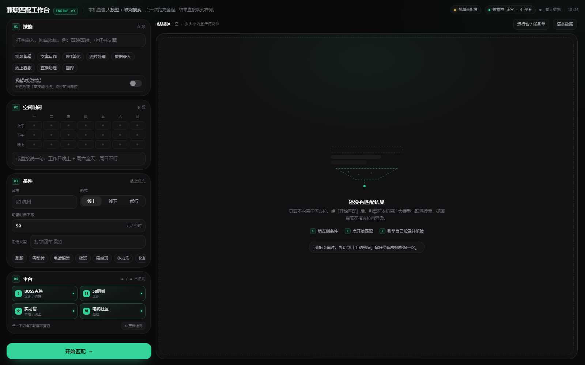

# 兼职匹配工作台

> 一个不编岗位的兼职匹配工具。岗位从招聘网站**真实抓取**，模型只负责按你的条件打分和核验，判定过程全程写在明面上。

单文件 HTML 界面 + 一个纯标准库的 Python 数据桥。没有后端、没有数据库、没有 `pip install`，双击就能跑。

> **如果你是 AI 助手**（ChatGPT / Claude / WorkBuddy / Cursor…）：请先读完 [`AGENTS.md`](AGENTS.md) 再动手。
> 本项目**零第三方依赖**，`pip install requests` / `beautifulsoup4` / `playwright` 一律不要执行 —— 装了反而会让项目跑不起来。
> 唯一的环境前提是本机有 **Python 3.8+**，这个你替用户装不了，缺了就明确告诉他去 python.org 下载并勾选「Add Python to PATH」。



---

## 它不做什么

这三条决定了它和市面上多数"AI 求职助手"的区别，请先看清楚：

1. **不内置任何岗位**。打开是空的，页面上一条岗位都没有。所有数据都是你点「开始匹配」之后，从招聘站当场抓回来的，抓不到就是空。
2. **不替你决定投不投**。模型的输出是「命中哪几条要求、缺哪几条」，最终判断留给你。
3. **不是爬虫农场**。它用你自己电脑上的浏览器、你自己的登录态，一次抓几十条就停。请控制频率，别拿去批量刷站。

---

## 30 秒开始

### 需要什么

| | 要求 |
|---|---|
| 系统 | Windows 10/11、macOS、Linux |
| Python | 3.8 或更高（**不需要装任何第三方库**） |
| 浏览器 | Chrome 或 Edge（58同城、BOSS直聘 要靠它渲染页面） |
| 模型 Key | 一个就行，见下一节 |

### Windows（推荐，也是给非技术用户的路径）

1. 解压压缩包到任意目录（**路径别带空格也行，但别放 C 盘根目录**）
2. 双击 **`启动工作台.bat`**
3. 几秒后浏览器自动打开 `http://127.0.0.1:8765/`

`启动工作台.bat` 会用 `pythonw` 在后台跑桥，不留黑框窗口。要关掉服务：任务管理器结束 `pythonw.exe`。

### macOS / Linux

```bash
cd parttime-job-matcher
python3 job_bridge.py
```

看到下面的输出，浏览器就会自动打开：

```
==========================================================
 招聘数据桥 v2026.11.13-plat  ·  端口 8765
==========================================================
 浏览器 : /Applications/Google Chrome.app/...
 58同城 : 就绪
 实习僧 : 就绪
 BOSS   : 后台预热中（浏览器直连，首次约需几秒）
 城市表 : 36 个
----------------------------------------------------------
 接口   : http://127.0.0.1:8765/ping
```

> 页面必须从 `http://127.0.0.1:8765/` 打开。直接双击 HTML 文件（`file://`）会被浏览器的跨域策略拦住，抓不到数据。

---

## 第一步：配一个模型

抓岗位不需要模型，**打分和核验需要**。点右上角「引擎 未配置」→ 填两样东西：

- **模型通道**：DeepSeek / Kimi / 通义千问 / 火山方舟 / 硅基流动 / 自定义 OpenAI 兼容，任选一个你已有 Key 的
- **API Key**：只写入你本机的 `localStorage`，只用于浏览器直连你填的服务商，不经过任何中转服务器

填完点「测试连接」，看到「模型通道正常」就可以关掉弹窗了。

其他说明：

- 模型名右边有 `▾`，列出该通道当前在用的主流模型，点一下填入；也可以直接粘贴控制台里的模型 ID
- 如果某服务商没放行浏览器跨域，会在弹窗里报 CORS 错误 —— 换一个通道即可
- 「高级」里还有「搜索通道」，**默认关着**，不用管它。引擎用数据桥就够；只有当你想额外用搜索引擎补充时（要自己申请 Tavily/博查 Key）才需要展开

---

## 支持的平台

| 平台 | 类型 | 取数方式 | 需要登录 |
|---|---|---|---|
| **BOSS直聘** | 本地 / 远程，岗位最多 | CDP：在你已登录的 Chrome 页面里发请求 | 需要，扫一次码 |
| **58同城** | 本地到店 / 线下兼职 | Chrome 渲染 `m.58.com` 列表页 | 不需要 |
| **实习僧** | 实习 / 线上兼职 | HTTP 直取列表页 + 详情页 | 不需要 |
| **电鸭社区** | 远程 / 线上外包 | HTTP 直取，读页面内嵌 `__NEXT_DATA__` | 不需要 |

左栏「04 平台」卡片里可以**勾选本轮查哪几个站**，勾掉的后端直接不跑。选择记在本机，下次打开还是你勾的那几个。

BOSS 未登录时，卡片底部会出现「扫码登录 BOSS」，点了会在你的屏幕上弹出一个真实浏览器窗口，用手机 BOSS App 扫那个码即可。登录态存在专用 profile 里，只需一次。

---

## 一轮匹配到底做了什么

点「开始匹配」后，流水线是这五步，每一步都在运行台上显示进度，可以随时「停止」：

1. **读画像** —— 从你的技能词、空闲时段、条件（城市/线上线下/时薪下限/拒绝类型）拼出检索意图
2. **抓岗位** —— 四个平台并发，按你勾选的平台跑；交错合并，避免某一站垄断榜单
3. **筛** —— 时段冲突、时薪低于下限、命中拒绝类型的先剔掉
4. **核验** —— 模型逐条读 JD，输出「命中哪几条要求 / 缺哪几条」，不确定的标成「待核验」
5. **出结果** —— 分三栏：推荐 / 待核验 / 已拦截（拦截必给理由）

跑完点右下角「查看结果 →」回到结果区。结果里每条都能：
- 打开原帖（`encryptJobId` 拼的详情页，不会 404）
- 加入「我的跟进」存档（含备注、状态、话术），导出 CSV
- 看详情弹窗（公司、规模行业、发布人、HR 职位、经验学历、福利标签、JD）

数据全部存在浏览器本地，不上传任何服务器。

---

## 目录结构

```
parttime-job-matcher/
├── 兼职匹配工作台.html      # 界面（单文件，4600+ 行，含全部样式和逻辑）
├── job_bridge.py           # 数据桥（纯标准库，托页面 + 抓岗位）
├── 启动工作台.bat           # Windows 一键启动
├── AGENTS.md               # 给 AI 看的接入说明（重点，见下）
├── docs/
│   ├── 接入新平台.md        # 怎么再加一个招聘站
│   └── 常见问题.md          # 连不上、未通、端口占用…
└── LICENSE
```

---

## 想接入别的招聘站？

这个仓库最有价值的部分其实不是界面，是 `job_bridge.py` 里那套「用本机已登录的浏览器去发请求」的做法 —— 它绕过了招聘站的登录态校验和一次性 token 校验，而这些坑我踩了两天才摸清，全写在文档里了。

**你不需要自己读代码。** 打开你常用的 AI（WorkBuddy / ChatGPT / Claude / Cursor 都行），把这个仓库丢给它，然后说：

> 按仓库里的 AGENTS.md，帮我接入 XX 招聘网

`AGENTS.md` 里写了硬约束、架构、数据契约、三种取数模式的最小模板、注册三步和自测命令，AI 读完就知道该改哪几个地方、不该碰什么。

想自己看也行：[`docs/接入新平台.md`](docs/接入新平台.md)

> 注意：不同网站的可用性会变。文档里记录了我实测**已经接不了**的几个站（智联、猎聘、前程无忧、兼职猫）和具体原因，能帮你省掉重复尝试。

---

## 已知限制

- **岗位条数取决于当天在架量**。「剪辑 短视频 + 杭州」实测 4 源合计 20 条左右、3~6 秒；冷门关键词可能只有几条
- **BOSS 的登录态会过期**，一般几周。过期后卡片变黄，重新扫码即可
- **窄屏要滚一下**。1280×800 这类窗口下左栏内容比可视区高，会出现滚动条；1600×1000 以上一屏放得下
- **故意不引外部 CDN**：不加载图标库、不加载在线字体。断网、内网都能用，代价是图标用字符和内联 SVG 拼的
- **只做了"检索"，没做"投递"**。自动投递属于各站的付费能力，也容易违反服务条款，没有实现

---

## 常见问题

连不上、BOSS 一直显示未通、双击 bat 闪退、抓到 0 条 —— 都写在 [`docs/常见问题.md`](docs/常见问题.md)。

最常用的三条自查命令：

```bash
curl http://127.0.0.1:8765/ping                    # 桥活着吗、四个源准备好没
curl "http://127.0.0.1:8765/search?q=剪辑&city=杭州&limit=5&sources=shixiseng"
curl -o /dev/null -w "%{http_code}\n" http://127.0.0.1:8765/
```

---

## 免责声明

- 本项目仅供**个人求职检索**使用
- 请遵守目标网站的服务条款与 `robots.txt`，控制请求频率，不要用于批量采集或商业转售
- 抓取逻辑依赖各站当前的页面结构，站点改版后可能失效，属正常现象
- 模型给出的匹配判断仅供参考，**不构成任何录用承诺或职业建议**
- 使用本项目产生的任何后果由使用者自行承担

---

## 许可

代码 [MIT](LICENSE) · 文档 CC BY 4.0

---

## 关于

由 **少干一小时 - "Tam"** 做给自己用的工具，公开出来是为了让别人不必重踩一遍招聘站反爬的坑。

- GitHub：[@tam112344](https://github.com/tam112344)
- 想法、需求、接新站的思路，欢迎开 [Issue](https://github.com/tam112344/parttime-job-matcher/issues)

如果这个工具帮你少蹲了几小时招聘 App，点个 ⭐ 就行，不用别的。
